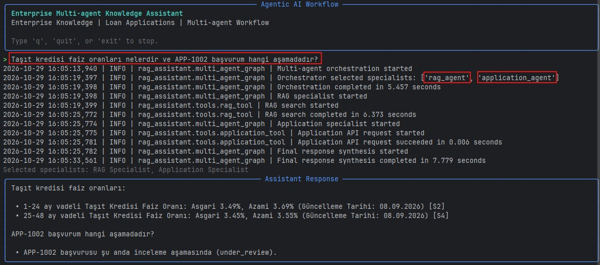

# Enterprise Multi-Agent Knowledge Assistant

An agentic AI workflow that combines enterprise-document retrieval with a REST API to answer banking knowledge questions and loan-application status queries. Built with Python, LangChain, LangGraph, ChromaDB, and Ollama (or an OpenAI/Azure OpenAI chat model).

## Overview

The workflow uses an orchestrator to decide which specialist is needed for a user request:

- **Orchestrator** — interprets the request and routes it to one or both specialists.
- **RAG specialist** — searches indexed enterprise documents using hybrid retrieval (Chroma dense retrieval + BM25, combined with reciprocal rank fusion) and returns a grounded answer with source references such as `[S1]`.
- **Application specialist** — calls a mock FastAPI service to retrieve a loan application status.
- **Response synthesis** — combines specialist results into one answer in the user's language.

The current workflow runs the specialists sequentially when both are required. The application is a terminal-based demo; it does not include a web UI.

## Demo

The terminal-based assistant demonstrates how the orchestrator selects the appropriate specialists for a combined request. In this example, both the RAG Specialist and the Application Specialist are selected to retrieve banking product information and a loan application's status.



## Architecture

```text
                         User question
                               |
                               v
                         Orchestrator
                         /           \
                        v             v
                 RAG specialist   Application specialist
                        |             |
                 ChromaDB + BM25   Mock FastAPI REST API
                        \             /
                         v           v
                       Final response
```

## Prerequisites

- Python 3.13 (the project was developed and tested with Python 3.13.5)
- [Ollama](https://ollama.com/) for local inference, or credentials for OpenAI/Azure OpenAI
- The enterprise source documents used to build the RAG index

The default configuration uses Ollama with `gpt-oss:20b`. Make sure the model is available locally before running the assistant:

```powershell
ollama pull gpt-oss:20b
```

You can select another provider through the environment configuration described below.

## Setup

Run the following commands from the repository root in PowerShell.

### 1. Create and activate a virtual environment

```powershell
python -m venv .venv
.\.venv\Scripts\Activate.ps1
```

### 2. Install dependencies

```powershell
python -m pip install --upgrade pip
pip install -r requirements.txt
```

### 3. Configure the LLM provider

Create a local `.env` file from the example:

```powershell
Copy-Item .env.example .env
```

The default settings use Ollama and do not require an API key:

```dotenv
LLM_PROVIDER=ollama
OLLAMA_BASE_URL=http://localhost:11434
OLLAMA_MODEL=gpt-oss:20b
```

Alternatively, set `LLM_PROVIDER=openai` and provide `OPENAI_API_KEY` and `OPENAI_MODEL`, or set `LLM_PROVIDER=azure` and provide the Azure OpenAI settings shown in `.env.example`. Never commit `.env` or API credentials.

### 4. Prepare source documents and build ChromaDB

This repository expects the source documents to be available under `data/documents/`. The document files themselves and the generated vector database are not committed to this repository.

For information about the source-document preparation and the underlying enterprise RAG project, see [Enterprise RAG Assistant](https://github.com/milsever/enterprise-rag-assistant).

After placing the required source documents under `data/documents/`, build the local ChromaDB index:

```powershell
$env:PYTHONPATH = "src"
python -m rag_assistant.ingest
```

The ingestion script reads supported PDF and JSONL files, creates embeddings using `sentence-transformers/paraphrase-multilingual-MiniLM-L12-v2`, and creates the ChromaDB collection under `data/chroma/`. The assistant will report an error if the index is missing or empty.

## Run the assistant

Keep the virtual environment active and set the source path in each new PowerShell terminal.

### 1. Start the mock loan-application API

In the first terminal:

```powershell
$env:PYTHONPATH = "src"
python -m uvicorn rag_assistant.mock_customer_api:app --host 127.0.0.1 --port 8001
```

The API provides:

- `GET http://127.0.0.1:8001/health`
- `GET http://127.0.0.1:8001/applications/{application_id}`

Sample application IDs:

| Application ID | Status |
|---|---|
| `APP-1001` | `approved` |
| `APP-1002` | `under_review` |
| `APP-1003` | `rejected` |

Unknown IDs, such as `APP-9999`, return HTTP 404. This is a mock API for demonstration and testing; it does not connect to a real bank or customer system.

### 2. Start the assistant

In a second terminal:

```powershell
$env:PYTHONPATH = "src"
python -m rag_assistant.ask
```

Enter a question at the prompt. Type `q`, `quit`, or `exit` to stop.

Example questions:

- `Taşıt kredisi faiz oranları ve ilgili koşulları nelerdir?`
- `APP-1002 numaralı kredi başvurumun durumu nedir?`
- `Taşıt kredisi faiz oranları nelerdir ve APP-1002 başvurum hangi aşamada?`

The orchestrator should select the RAG specialist, the application specialist, or both depending on the request.

## Run tests

From the repository root:

```powershell
$env:PYTHONPATH = "src"
python -m pytest -v
```

The test suite covers agent routing, combined requests, RAG behavior, hybrid retrieval, and application API error handling. Tests use mocks where appropriate and do not require live LLM calls for the covered workflows.

## Project structure

```text
src/rag_assistant/
├── ask.py                         # Terminal chat interface
├── multi_agent_graph.py           # Orchestrator and specialist workflow
├── agent_graph.py                 # Original single-agent workflow
├── rag_graph.py                   # RAG workflow
├── ingest.py                      # Build the local ChromaDB index
├── mock_customer_api.py           # Mock FastAPI application service
├── llm/factory.py                 # LLM provider configuration
├── retrieval/                      # ChromaDB + BM25 hybrid retrieval
└── tools/                          # RAG and application API tools

tests/                              # Automated tests
assets/screenshots/                 # Project screenshots
data/
├── documents/                      # Local source documents (not committed)
└── chroma/                         # Generated ChromaDB index (not committed)
```

## Technology stack

- Python
- LangChain and LangGraph
- Ollama, with optional OpenAI and Azure OpenAI providers
- ChromaDB and Hugging Face Sentence Transformers embeddings
- BM25 and reciprocal rank fusion for hybrid retrieval
- FastAPI and Uvicorn for the mock application API
- pytest for automated tests
- Rich for the terminal interface

## Scope and limitations

- The loan-application API is mock data for demonstration only.
- The ChromaDB index and source documents must be prepared locally; they are not included in the repository.
- The assistant's document answers depend on the contents and quality of the locally indexed source documents.
- The current multi-agent workflow uses explicit specialist nodes and an orchestrator; it is not a web application.

## Related project

The document ingestion and enterprise RAG foundation are related to [Enterprise RAG Assistant](https://github.com/milsever/enterprise-rag-assistant).
